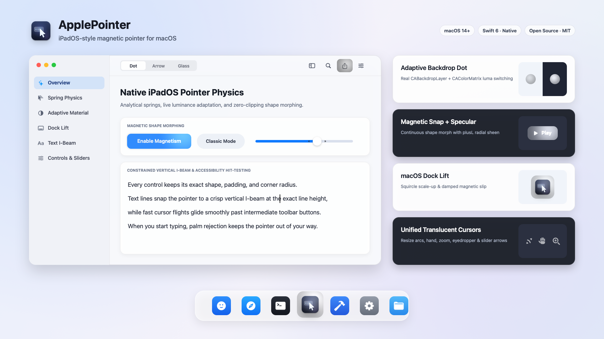
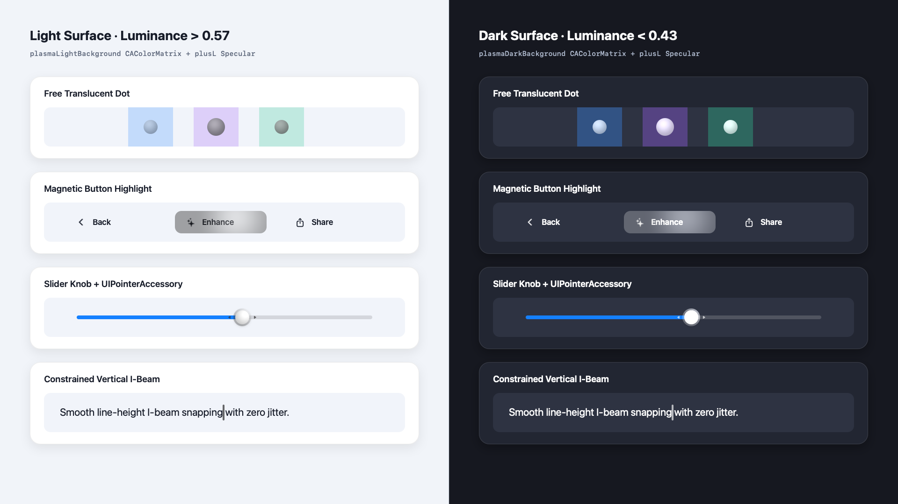
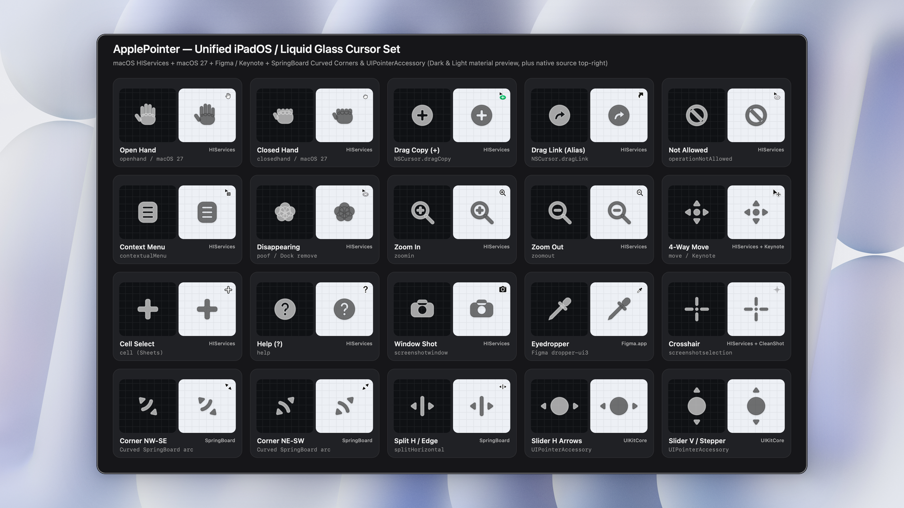
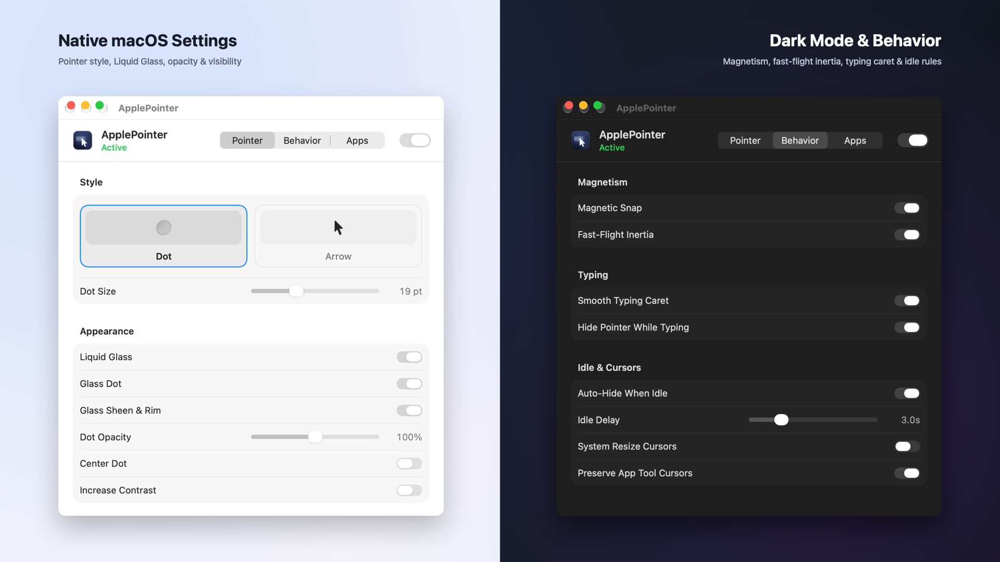

# ApplePointer

iPadOS-style magnetic pointer for macOS — analytical spring physics, live backdrop luminance adaptation, Dock lift, constrained text I-beam, and a unified translucent cursor set.



## What It Does

ApplePointer replaces or augments the macOS system cursor with a native overlay that follows the same interaction model as iPadOS pointer services:

- **Magnetic Snap & Continuous Shape Morphing** — Uses macOS Accessibility hit-testing and geometry resolution to snap cleanly onto buttons, toolbar items, segmented controls, sidebar rows, tabs, sliders, and menu bar items while preserving their padding and corner radii.
- **Analytical Spring Physics** — Critically and underdamped analytical 1D springs drive position, shape morphing, slip damping, press compression, fast-flight inertia (skipping intermediate buttons during rapid pointer flights), and idle auto-hide wake-up.
- **Adaptive Backdrop Material** — Renders via native `CABackdropLayer` + `CAColorMatrix` luminance switching (light/dark thresholds `0.43 / 0.57`) with radial `plusL` specular highlight tracking cursor slip. Supports both **Liquid Glass** and **Classic iPadOS** material presets, plus **Dot** and **Arrow** pointer styles.
- **macOS Dock Lift** — Scales and softly slips over Dock application icons with damped magnetic resistance.
- **Constrained Vertical I-Beam & Smooth Typing Caret** — Morphs into a line-height-matched vertical I-beam over text fields and editors, includes a VS Code-style smooth gliding typing caret, and hides the pointer while typing with trackpad palm rejection.
- **Unified Translucent Cursor Set** — Renders resize arrows, SpringBoard curved window-corner arcs, split dividers, open/closed hand, zoom, eyedropper, crosshair, and `UIPointerAccessory` slider chevrons in one consistent translucent material language, while automatically yielding to screen capture overlays (macOS Screenshot, CleanShot X) and optional bespoke creative tool cursors.



## Unified Cursor Set



## Settings

ApplePointer lives quietly in the menu bar (`⌃⌥⌘P` toggles it on or off anytime) and includes a native SwiftUI Settings window for both Light and Dark Mode:



- **Pointer**: Dot or Arrow style, size slider, Liquid Glass / Classic material, specular highlight, dot opacity, optional center dot, increase contrast, Shake to Find, and Accessibility Zoom scaling.
- **Behavior**: Magnetic Snap, Fast-Flight Inertia, Smooth Typing Caret, Hide Pointer While Typing, Auto-Hide When Idle, native resize cursor toggle, and custom app tool cursor passthrough.
- **Apps**: Launch at Login and per-app exclusion list (Remote Desktop / screen-sharing apps are excluded by default).

## Install

Download the Universal (`arm64` + `x86_64`) DMG or ZIP from [Releases](https://github.com/SergeiNikolenko/ApplePointer/releases/latest) (requires **macOS 14 Sonoma or later**):

1. Open `ApplePointer-1.0.0.dmg` and drag **ApplePointer.app** to `/Applications`.
2. Because this open-source build is ad-hoc signed rather than Apple notarized, clear the quarantine attribute if macOS blocks the first launch:

```bash
xattr -dr com.apple.quarantine /Applications/ApplePointer.app
```

3. Launch **ApplePointer** and grant **Accessibility** permission when prompted (`System Settings → Privacy & Security → Accessibility`) so the app can read UI control bounds for magnetic snapping.

## Build From Source

Requires macOS 14+ and Swift 6 (Xcode 16+):

```bash
# Run unit & physics contract tests
swift test

# Build a local .app bundle (outputs to build/ApplePointer.app)
./scripts/build-app.sh

# Build a Universal (arm64 + x86_64) .app bundle and DMG
APPLEPOINTER_UNIVERSAL=1 ./scripts/build-app.sh
./scripts/create-dmg.sh build/ApplePointer.app build/ApplePointer.dmg
```

## Architecture

- `Sources/ApplePointerCore/` — Pure Swift simulation and geometry engine (`PointerEngine`, `SpringPhysics`, `ColorMatrix`, `ElementGeometryResolver`, `PointerGlyphPaths`, `CursorHideSafetyPolicy`), decoupled from AppKit for fast unit testing.
- `Sources/ApplePointer/` — macOS AppKit / SwiftUI runtime: full-screen pass-through overlay panels (`OverlayWindowController`), Accessibility hit-testing (`AccessibilityHitTester`), global event tap (`EventTapManager`), system cursor visibility management (`SystemCursorHider`), menu bar status item, and Settings UI.
- `Tests/ApplePointerCoreTests/` — Contract tests covering spring convergence, fast-flight inertia, Dock lift, constrained text I-beam, luminance hysteresis, color matrices, geometry resolution, and screen-capture safety policies.

## License

MIT — see [LICENSE](LICENSE).

